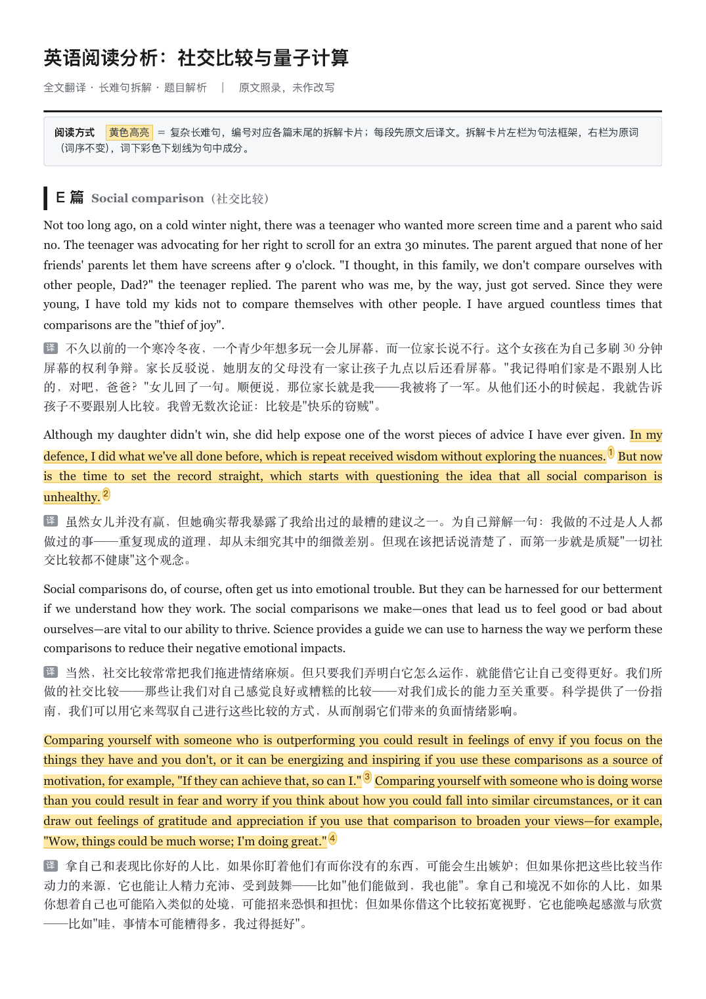
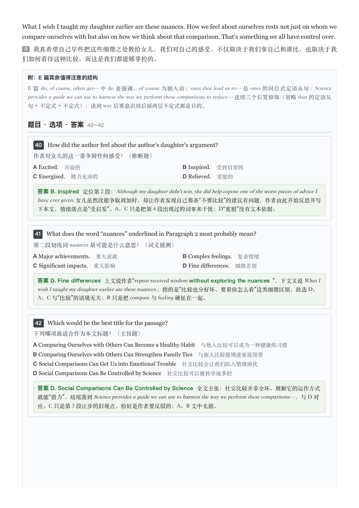
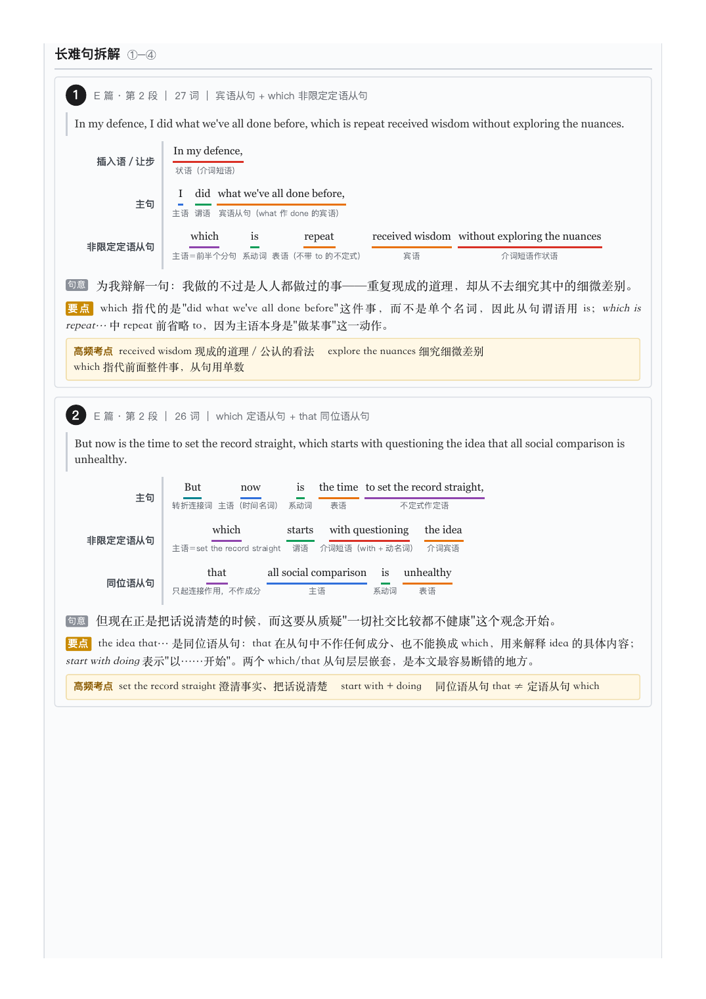

# English Reading → Chinese · Reading Comprehension Analyzer (Agent Skill)

[](https://github.com/MelanthaCode/english-reading-analysis/stargazers)
[](LICENSE)
[](https://www.skills.sh)

An [Agent Skill](SKILL.md) that turns **English reading passages and exam papers into a Chinese study document**: paragraph-by-paragraph translation, translated questions and options with answers and source-line explanations, wrong-answer analysis, long-sentence syntax breakdown, and a print-ready A4 PDF.

Works with any agent that supports the Agent Skills convention (`SKILL.md` plus sibling resource files): **Claude Code, Codex, GitHub Copilot, Cursor, Windsurf, Gemini CLI, OpenCode, Amp, Cline, DeepSeek Harness**, and others.

[中文说明 →](README.md)

## Install

```bash
npx skills add MelanthaCode/english-reading-analysis
```

This installs a universal copy into `.agents/skills/english-reading-analysis/` and symlinks it for Claude Code — one command, about 20 agents, no per-vendor configuration.

Other routes:

```bash
# Claude Code plugin marketplace
claude plugin marketplace add MelanthaCode/english-reading-analysis
claude plugin install english-reading-analysis@melantha-skills

# Manual
git clone https://github.com/MelanthaCode/english-reading-analysis.git \
  ~/.claude/skills/english-reading-analysis
```

## What it does

| Input | Output |
|---|---|
| An English passage (text, scanned PDF, or phone photo) | Chinese analysis document |
| An English exam paper | Translated questions, options, answers with source-line reasoning |
| A marked / graded paper | Per-question verdicts, error categories, corrective hints |

Document structure, repeated per passage:

```
Passage N: <topic>
  1. Original text + Chinese translation    paragraph-aligned, no rewriting
  2. Questions · options · answers          bilingual, answer traced to the source sentence
  3. Answer / error analysis                only when the student's answers are provided
  4. Long-sentence breakdown                frame on the left, original word order on the right
```

Rendering to A4 PDF is done locally with headless Chrome; card and question blocks never split across pages.

## Preview







## Privacy

- **No network calls.** `scripts/render_pdf.py` shells out to a local Chrome only — no HTTP, no telemetry, nothing uploaded.
- **Local only.** Your passages, papers and photos are read and rendered on your own machine.
- **Auditable.** The whole skill is Markdown plus one ~120-line Python file: no build step, no dependencies, no binaries.
- **MIT licensed.**

## Requirements

| Purpose | Needs |
|---|---|
| A4 PDF rendering | Google Chrome / Chromium / Edge, installed in its default location |
| Scanning images from PDFs | `pdftoppm` (poppler) |
| Running the helper script | Python 3.9+ |

**Windows:** Chrome and Edge are not on `PATH`, so the script resolves them from the registry `App Paths` keys and the standard `Program Files`, `Program Files (x86)` and `%LOCALAPPDATA%` install roots. Check it with:

```bash
python3 scripts/render_pdf.py --check
```

If your browser lives somewhere unusual, pass it explicitly with `--chrome "D:\path\to\chrome.exe"`.

## Repository layout

```
english-reading-analysis/
├── SKILL.md                    # entry point: structure, workflow, acceptance checks
├── .claude-plugin/             # Claude Code plugin + marketplace manifests
├── references/                 # sentence analysis, paper workflow, PDF layout
├── assets/                     # HTML template, README screenshots
└── scripts/render_pdf.py       # HTML → A4 PDF
```

## License

MIT
