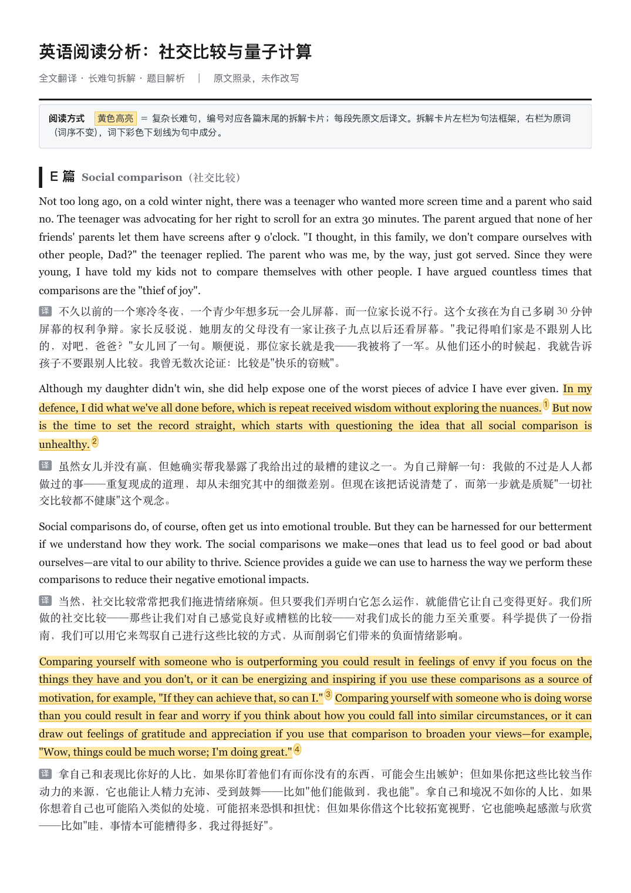
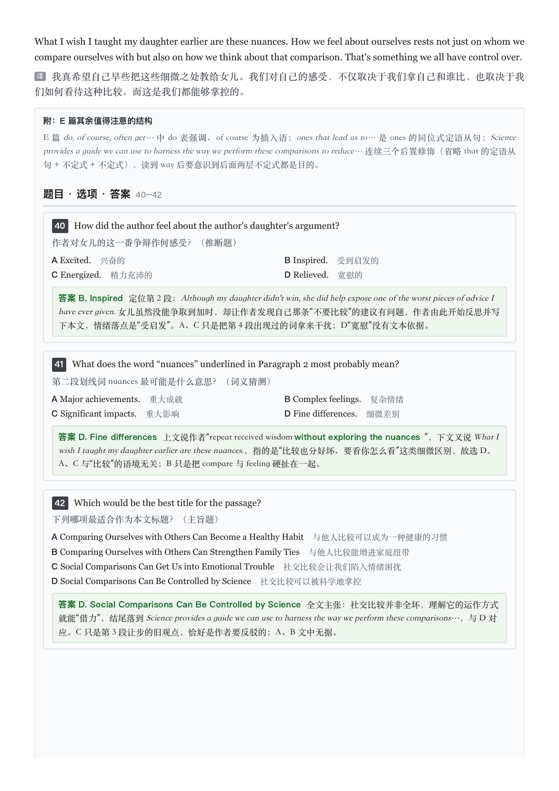
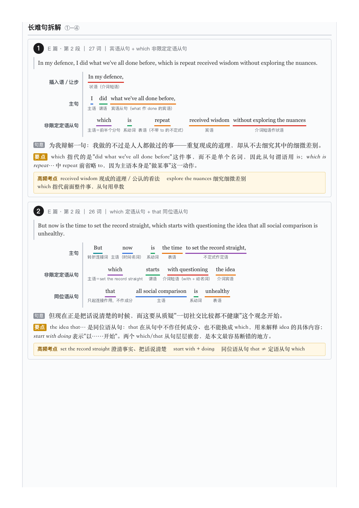

# 英语阅读 → 中文 · English Reading to Chinese

一个给 AI Agent 用的技能：把**英语阅读材料转成中文**——文章逐段翻译，试卷题目与选项翻译并给出答案，复杂长难句做句法拆解，最后输出一份可打印的 A4 文档。

核心是**英译中**：长难句分析是其中一环，不是全部。

适用于 Claude Code、Codex、DeepSeek Harness 等支持 Agent Skills（`SKILL.md` + 资源目录）的工具。

## 预览

**① 文章：逐段原文 + 中文译文，复杂长难句高亮编号**



**② 题目 · 选项 · 答案：题干与选项中英对照，答案附原文定位解析**



**③ 长难句拆解：左栏为句子/从句级框架，右栏为原词（词序不变），词下彩色下划线标成分**



## 输出结构

每篇文章独立成块，块内顺序固定：

```
文章 1：<主题>
  1. 原文 + 译文          英译中，逐段对照
  2. 题目 · 选项 · 答案    题干与选项中英对照、答案、原文定位解析
  3. 作答对错分析          仅在提供作答时：逐题对错、错因归类、纠正提示
  4. 长难句拆解            左栏句法框架 / 右栏原词，彩色下划线标成分
```

多篇文章按同样结构逐篇重复；没有的环节直接省略。

## 特点

- **以译为主**：原文照录不改写，译文准确优先于文采，保留因果、对比、程度与挂接关系。
- **长难句单次呈现**：一个句子只出现一次，左侧标句子/从句级框架，右侧保留原词序，不重复三遍同一句话。
- **题目可核对**：题干、选项都翻译，答案指回原文句子，并说明干扰项错在哪。
- **可直接打印**：HTML + headless Chrome 渲染 A4 PDF，卡片与题块不跨页，标题不孤行。
- **无身份噪声**：标题、页脚、文件名只写文章主题，不带学校名、考试名、原卷页码。

## 安装

把整个目录放到你的 Agent 技能目录下（目录名即技能名）：

```bash
git clone https://github.com/melanthcode/english-reading-analysis.git \
  ~/.claude/skills/english-reading-analysis      # Claude Code
# 或
  ~/.codex/skills/english-reading-analysis       # Codex
# 或
  ~/.dsh/skills/english-reading-analysis         # DeepSeek Harness
```

通用做法：放在项目根的 `.agents/skills/english-reading-analysis`（多数支持 Agent Skills 约定的工具会扫描该路径）。

## 依赖

| 用途 | 需要 |
|---|---|
| 渲染 PDF | Google Chrome / Chromium / Edge（任一） |
| 读取扫描件 | `pdftoppm`（poppler） |
| 运行脚本 | Python 3.9+ |

```bash
brew install poppler            # macOS 读扫描件用
python3 scripts/render_pdf.py 输入.html 输出.pdf
```

## 用法示例

> 把这篇英语文章翻成中文，复杂长难句高亮，文末单独拆解。

> 这份英语试卷（扫描件）：逐篇翻成中文，题目和选项都要中英对照，给出答案和解析，再按每篇做长难句分析。

> 这是我批改过的卷子，帮我把错题分析一下，错因归类，再针对每篇的难句做拆解。

## 目录

```
english-reading-analysis/
├── SKILL.md                       # 入口：结构、流程、验收清单
├── references/
│   ├── sentence-analysis.md       # 长难句：分析顺序、从句分类、展示规则、范例
│   ├── paper-workflow.md          # 试卷：题块字段、题型解法、干扰项、错因分类
│   └── layout-pdf.md              # 版式：CSS、分页、渲染命令、排错
├── assets/
│   ├── template.html              # 可直接套用的 HTML 模板
│   └── screenshots/               # README 用效果图
└── scripts/
    └── render_pdf.py              # HTML → A4 PDF
```

## 设计取舍

- **为什么不用 Word**：高亮、词下彩色下划线、卡片级分页控制在 Word 里很难稳定，HTML + 打印更可控。
- **为什么段落不跨页**：英文原文与中文译文必须挨着看，拆到两页会打断对照阅读。
- **为什么句法框架只到句子/从句级**：把名词短语内部也拆成层级会让左栏膨胀，反而看不清主干。

## License

MIT
